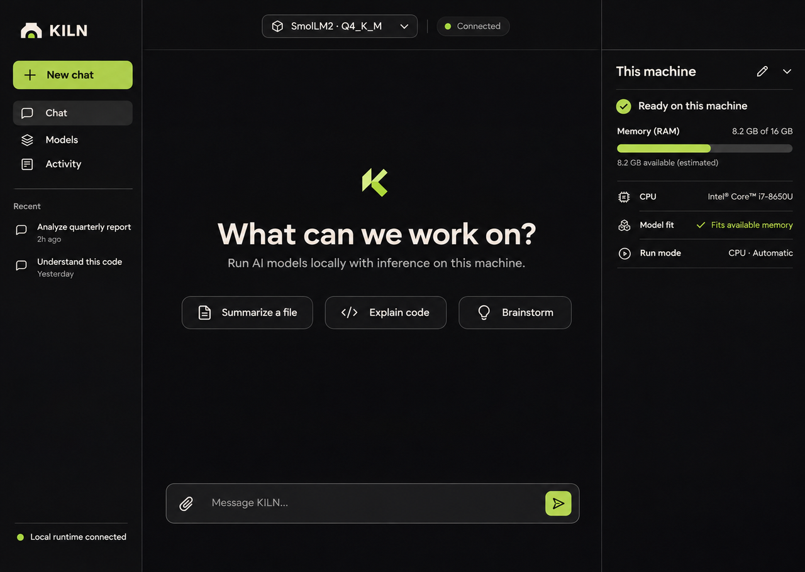

# KILN

**A local AI app that checks your computer and chooses a supported way to run an installed model.**

KILN includes a desktop app for Kali and Debian, local model management, and an Ollama-compatible API. It runs locally by default.

## Install and start

1. Download the amd64 or arm64 .deb from [KILN Releases](https://github.com/andreipath26/KILN/releases).
2. Install it:

       sudo apt install ./kiln-linux-ARCH-COMMIT.deb

3. Open **KILN** from the app menu.

KILN opens in its own desktop window, checks available resources, and starts a suitable installed model when possible. If you don’t have a model yet, open **Models** in the app to find and download a GGUF. Model downloads are explicit; KILN does not download weights during installation.

The desktop app and API run on this computer. Chat prompts are not sent to a cloud service.

## Desktop preview

These are approved design previews. The example model and hardware values are illustrative, not live readings from KILN.

## What works today

- Local chat with installed GGUF models and compatible Ollama model files.
- System assessment and automatic selection among suitable installed models.
- Public Hugging Face GGUF search and verified downloads from the Models page.
- A local API at 127.0.0.1:11435 for Ollama-compatible clients.
- Linux .deb packages with the desktop launcher and window dependencies.

KILN is still being developed. Its large-model speed, quality, memory, storage, and thermal targets have **not** been proven on the Dell Latitude 7490 test machine.

## Research features

CPU MoE expert streaming and LLaDA diffusion are experimental. They support only specific model layouts and have not met KILN’s target-hardware acceptance tests. Passing CI or running these features does not establish useful speed or quality.

## For developers

To build from source, clone with submodules, build the pinned llama.cpp libraries, then build the Rust workspace. Detailed commands and model workflows are in the [developer documentation](docs/README.md).

To collect the configured measurements in one run, see the [Tier 0 qualification example](docs/tier0-qualification.example.json). The [Phase 3.5 guide](docs/phase35-measurement.md), [Phase 5 guide](docs/phase5-streaming.md), and [Phase 6 guide](docs/phase6-diffusion.md) explain their individual evidence and limits.

The main branch publishes Linux previews. Versioned releases are the stable update channel. Previews and this project’s research targets are not deployment acceptance.

## Documentation

- [Documentation index](docs/README.md)
- [Architecture](docs/architecture.md)
- [UI architecture](docs/ui-architecture.md)
- [Measurement guide](docs/phase35-measurement.md)
- [MoE streaming guide](docs/phase5-streaming.md)
- [Diffusion guide](docs/phase6-diffusion.md)
- [Master roadmap](KILN%20MASTER%20ROADMAP%20AND%20RULES%20SET.md)
- [License](LICENSE)
