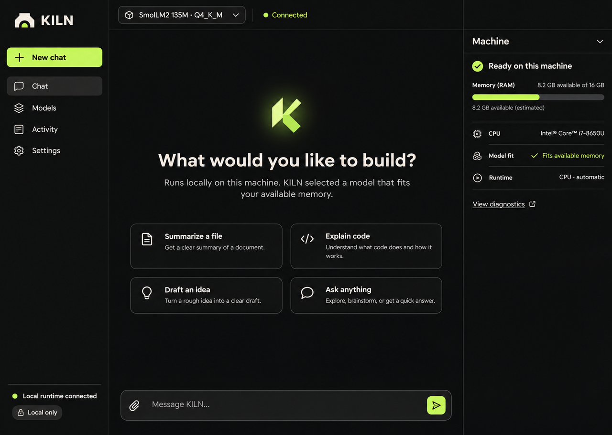

# KILN

**Local AI for the hardware you already own.**

KILN is a local-first AI desktop application and inference runtime. Discover and manage GGUF models, chat locally, inspect your machine, and connect tools through an Ollama-compatible API—all without requiring a cloud inference service.

Its bigger mission: **run models larger than available memory at usable speed** by coordinating compute, RAM and SSD storage, with special attention to sparse Mixture-of-Experts (MoE) models.

> **Status: Linux preview, not production-qualified.** Local chat and model management are available. Large-model MoE streaming, LLaDA diffusion, and KILN's ambitious speed and accuracy goals are still experimental or awaiting acceptance measurements on the reference laptop. [Current capabilities](#current-capabilities) · [Targets](#research-goals-and-acceptance)

[Install](#install-on-linux) · [Getting started](#getting-started) · [Desktop preview](#desktop-preview) · [API](#local-api) · [Architecture](#how-it-works) · [Research roadmap](#research-goals-and-acceptance) · [Contribute](#development)

## Why KILN?

A local model typically needs its weights to fit RAM or accelerator memory, or it pays a performance penalty to fetch them from slower storage. KILN is building toward an inference engine that understands **which computation and data are needed, when, and where to run them**.

- **Local by default.** Prompts, inference and the desktop workspace stay on your computer. Remote model search and downloads are explicit actions.
- **One workspace.** Chat, models, activity and system details share one runtime rather than separate inference engines.
- **Hardware-aware startup.** Detect available resources, find installed models, attempt suitable activation and expose failed attempts or fallbacks.
- **Model choice without lock-in.** Use compatible local GGUF models and an API familiar to Ollama clients.
- **Memory-first research.** Explore exact MoE expert streaming, bounded caches, asynchronous I/O and predictive prefetching for systems with limited RAM.
- **Evidence before performance claims.** Measure sustained tokens/s, correctness, memory, physical storage traffic and model quality on specified hardware.

The memory-first and heterogeneous-dispatch goals are **not** a statement that arbitrary oversized models or every CPU/GPU/NPU configuration work today.

## Install on Linux

KILN currently publishes Linux preview packages for **amd64** and **arm64**, including Debian packages intended for Debian/Kali-style systems.

1. Visit **[KILN Releases](https://github.com/andreipath26/KILN/releases)** and download the matching `.deb`.
2. Install the downloaded package, replacing the example filename with the real one:

   ```bash
   sudo apt install ./kiln-linux-ARCH-COMMIT.deb
   ```

3. Launch **KILN** from your desktop application menu.

The package declares the GTK/WebKit dependencies needed for KILN's native desktop window. KILN does **not** download model weights during installation. A published preview package and passing hosted CI do not by themselves certify your particular machine, distribution or model.

### Getting started

1. Open KILN. It checks local resources and searches for installed models.
2. Open **Models** if you need a model. Browse the local library or explicitly search/download a public Hugging Face GGUF.
3. Activate a compatible model, then open **Chat**.
4. Use **System details** to inspect the startup assessment, runtime state and any reported compatibility or fallback problems.
5. Use **Activity** to manage local conversations and history.

KILN may attempt to start a suitable installed model automatically, but availability depends on memory, model architecture, quantization and backend support. **Being listed in the library does not guarantee successful inference.** An internet connection is not needed for inference with an already installed, supported model.

## Desktop preview

These are **design previews**, not live runtime screenshots or measured hardware/model performance. Example values are illustrative.




## Current capabilities

| Capability | Status | Important limitation |
| --- | --- | --- |
| Local desktop chat and conversation history | **Linux preview** | Supported GGUF architecture/format and available memory required |
| Models view, local inventory and activation | **Implemented** | Inventory recognition is not proof of backend compatibility |
| Public GGUF search and verified downloads | **Implemented** | Explicit network action; availability and licensing vary |
| System assessment and auto-selection | **Implemented, limited** | CPU/RAM-oriented startup heuristics; not complete heterogeneous placement |
| Ollama-compatible local API | **Implemented** | Supported endpoints only, not full Ollama feature parity |
| Debian packaging and desktop launcher | **Implemented, CI-tested** | Real Kali/target-machine qualification remains open |
| TQ1.0 ternary path and canary/watchdog safeguards | **Implemented** | Bit packing or a passing test does not prove whole-model quality/speed |
| Native selected-expert MoE inference for supported GGUF layouts | **Experimental** | End-to-end Tier 0 speed, RAM, I/O and accuracy unproven |
| Expert sidecars, byte-bounded cache, prefetch and `cpu_moe_streamed` | **Components implemented** | Not all integrated into native model compute |
| LLaDA masked diffusion with CLAD | **Experimental CLI path** | Required reference-laptop speed and quality tests pending |
| General CPU/GPU/NPU per-layer execution | **Architecture/roadmap** | Device discovery is not execution parity or complete dispatch |
| Production-grade cross-platform release | **Not yet qualified** | Clean-machine, platform and acceptance matrices remain open |

**Implemented**, **CI-tested**, **target**, and **accepted on hardware** mean different things. KILN will not claim the original low-memory inference mission as achieved until the required end-to-end measurements exist.

## Local API

When the local KILN API is running, it listens on **`127.0.0.1:11435`** and provides Ollama-compatible endpoints including `/api/chat`, `/api/generate`, `/api/tags` and `/api/version`.

List available models:

```bash
curl http://127.0.0.1:11435/api/tags
```

The API is deliberately bound to loopback. It is **not** an authenticated public network server; do not treat it as safe to expose on an untrusted interface. See [UI/API architecture](docs/ui-architecture.md) for current coverage and boundaries.

## How it works

KILN is built around a Rust workspace and a pinned `llama.cpp` fork. The application exposes a single user-facing chat/model/API workflow, while its runtime components handle model metadata, execution, memory/I/O and diagnostics.

```text
              Desktop UI  /  CLI  /  Loopback API
                            |
                  Model & session services
                            |
                 KILN runtime / dispatcher
                            |
          +-----------------+-----------------+
          |                 |                 |
     Pinned llama.cpp   Memory / I/O     Diagnostics /
      native execution  experiments      benchmarks
          |                 |
      GGUF, kernels     Expert mapping,
      and model graph   cache, I/O, traces
```

**Already present:** native GGUF execution through supported paths, runtime/dispatcher interfaces, quantization, local API/UI, and research components for MoE expert reads and caches.

**Still being proved:** useful, correct, sustained end-to-end low-memory streaming on the target machine; integrating the appropriate prediction/cache/I/O policies with the actual model graph; and portable per-layer placement across different hardware topologies.

The experimental native selected-expert MoE graph path is **different from** the Rust `cpu_moe_streamed` byte-operation backend and the sidecar/prefetch experiments. Their existence does not mean they are all wired together in ordinary inference.

For implementation details see [architecture](docs/architecture.md), [runtime loading](docs/runtime-loading-design.md) and [MoE streaming guide](docs/phase5-streaming.md).

## Research goals and acceptance

### The reference machine

KILN's minimum acceptance platform is a **Dell Latitude 7490** with an **Intel i7-8650U**, **16 GB DDR4 RAM**, **CPU-only execution** and NVMe storage. This deliberately constrained laptop is the **test floor**, not the ceiling of intended hardware support.

| Track | Objective | Current assessment |
| --- | --- | --- |
| **Phase 3.5 — dense inference** | Reproduce the Qwen2.5-1.5B Q4_K baseline and fair Ollama comparison; historical target around **27 tok/s** | Controlled current-head benchmark still needed |
| **Phase 5 — MoE pilot** | Qwen3-30B-A3B at **≥3 tok/s**, **<15 GB** peak RAM and **≥85%** expert-cache hit target, with I/O, correctness and quality evidence | Implementation exists; hardware acceptance missing |
| **Phase 6 — diffusion** | LLaDA-8B CLAD at **≥6 generated tok/s**, with at most **1 percentage-point** factual-accuracy loss versus the same-model confidence decoder | Software implemented; Dell benchmark and quality comparison missing |
| **Long-term KILN mission** | **70B-class MoE (~4B active/token)** at **≥4 tok/s**, preserving the roadmap's WikiText-2 accuracy criterion | **Not demonstrated** |

Numbers above are **targets, not measured throughput claims**.

An earlier dense benchmark recorded **10.57 tok/s for KILN** versus **26.86 tok/s for Ollama** on a particular Qwen2.5-1.5B workload. Those figures are historical and not a fair current-head comparison; later cache and decoding changes need a pinned, repeated measurement before any performance headline is updated.

### Phase status

| Phase | Recorded roadmap status |
| --- | --- |
| 1, 1.5, 2, 3 | Complete foundations, fork integration and dispatcher |
| 3.5 | Dense speed and controlled baselines **in progress** |
| 4, 4.5 | Ternary representation and sanity/quality safeguards **implemented** |
| 5 | MoE streaming **experimental**; model/hardware acceptance open |
| 6 | Diffusion **software implemented**; CI and Tier 0 evidence open |
| 7 | Broad hardware abstraction **future work** |
| 8 | Linux desktop and packaging **in progress**; product qualification open |

The [**master roadmap**](KILN%20MASTER%20ROADMAP%20AND%20RULES%20SET.md) is the single authority for phase definitions, engineering rules, targets and dated evidence. This README is an accessible summary, not a substitute for the roadmap.

## Development

### Build from source (Linux developer path)

KILN currently uses a **pinned llama.cpp submodule** and a linked native development build. You need a Rust toolchain, CMake, a C/C++ compiler and the requisite native build dependencies.

```bash
git clone --recurse-submodules https://github.com/andreipath26/KILN.git
cd KILN

cmake -S vendor/llama.cpp -B vendor/llama.cpp/build \
  -DCMAKE_BUILD_TYPE=Release -DBUILD_SHARED_LIBS=OFF
cmake --build vendor/llama.cpp/build --config Release -j

cargo build -p kiln-cli
```

These commands describe the **developer build**, not a promise that all optional accelerators or platforms can be compiled from a clean checkout without extra dependencies. See [runtime-loading design](docs/runtime-loading-design.md) and [developer docs](docs/README.md).

### Measure rather than guess

The repository has a one-command measurement entry point for model experiments:

```bash
cargo run -p kiln-cli -- measure /path/to/model.gguf \
  --out ./measurements/model-run --tokens 128 --runs 5 --threads 4
```

The output directory must be new. Reports preserve provenance and stage logs; unsupported model paths, missing reference quality data and incomplete target-machine tests remain **inconclusive**, not passes.

- [Dense-path measurement protocol](docs/phase35-measurement.md)
- [MoE streaming implementation and evidence](docs/phase5-streaming.md)
- [Diffusion factual-suite protocol](docs/phase6-diffusion.md)
- [Tier 0 qualification example](docs/tier0-qualification.example.json)

For qualified performance claims, pin the model, tokenizer, KILN/fork commits, compiler/settings, prompt, run count, hardware, thermal conditions, baseline and accuracy metric.

## Privacy and model licenses

Inference is local by default. Public catalog search and chosen GGUF downloads contact remote services; installing and running a local model does not require hosted inference credentials. The loopback API is intended for local clients, not unauthenticated network exposure.

Model weights are distributed by their respective owners. Check each model's license, provenance and usage restrictions before downloading or redistributing it. KILN's own license is in [LICENSE](LICENSE); native dependencies and their notices have separate obligations.

## Documentation and project links

- **[Releases](https://github.com/andreipath26/KILN/releases)** — preview packages
- **[Master roadmap and engineering rules](KILN%20MASTER%20ROADMAP%20AND%20RULES%20SET.md)** — authoritative project status
- **[Documentation index](docs/README.md)** — maintained guides
- **[Architecture](docs/architecture.md)** and **[desktop/UI design](docs/ui-architecture.md)**
- **[Issues](https://github.com/andreipath26/KILN/issues)** · **[Pull requests](https://github.com/andreipath26/KILN/pulls)**

---

**KILN's promise is a direction to prove, not a benchmark to assume:** larger local models, practical resource use, measured speed and preserved quality—on hardware people already own.
